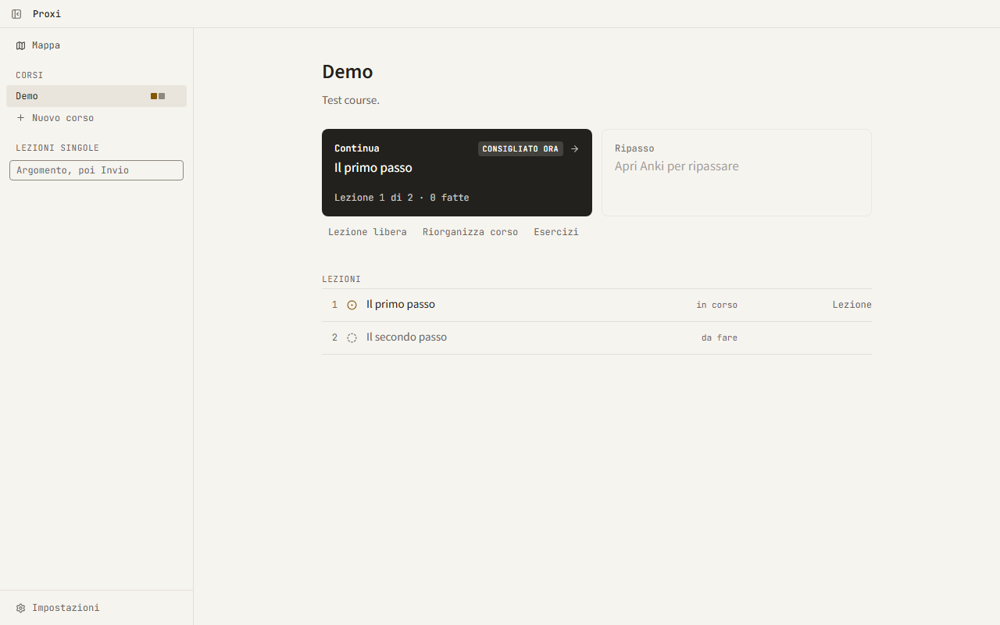

Heavily inspired by [LearnHarness](https://github.com/amosblomqvist/learnharness) and Matt Pocock's [/teach skill](https://github.com/mattpocock/skills/blob/main/skills/productivity/teach/SKILL.md), Proxi tries to get the best of both worlds and glue it to Anki spaced repetition, so what you learn actually stays.

You pick a topic and an AI agent teaches it to you in short interactive lessons, starting from what you already know.
Every lesson becomes Anki cards, and two buttons do the rest: Continue and Review.
The UI is in Italian for now.



## Install

```bash
git clone https://github.com/davidef02/proxi.git
cd proxi
npm install
npm run desktop
```

On Windows, `npm run desktop:install` adds Start menu and Desktop shortcuts.

## Requirements

- Node 24
- One AI CLI, installed and logged in: Claude Code (`claude`), Antigravity (`agy`) or OpenCode (`opencode`)
- Optional: Anki with the AnkiConnect add-on; without it, decks are exported as TSV files
- Windows, macOS or Linux (desktop shortcuts are Windows-only)

## Build

```bash
npm run app:build
npm test
```

## License

AGPL-3.0-only, see [LICENSE](LICENSE). Proxi is a modified fork of LearnHarness, see [NOTICE](NOTICE).
