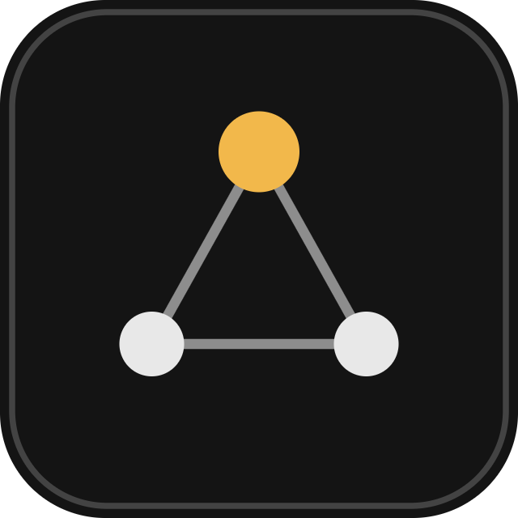
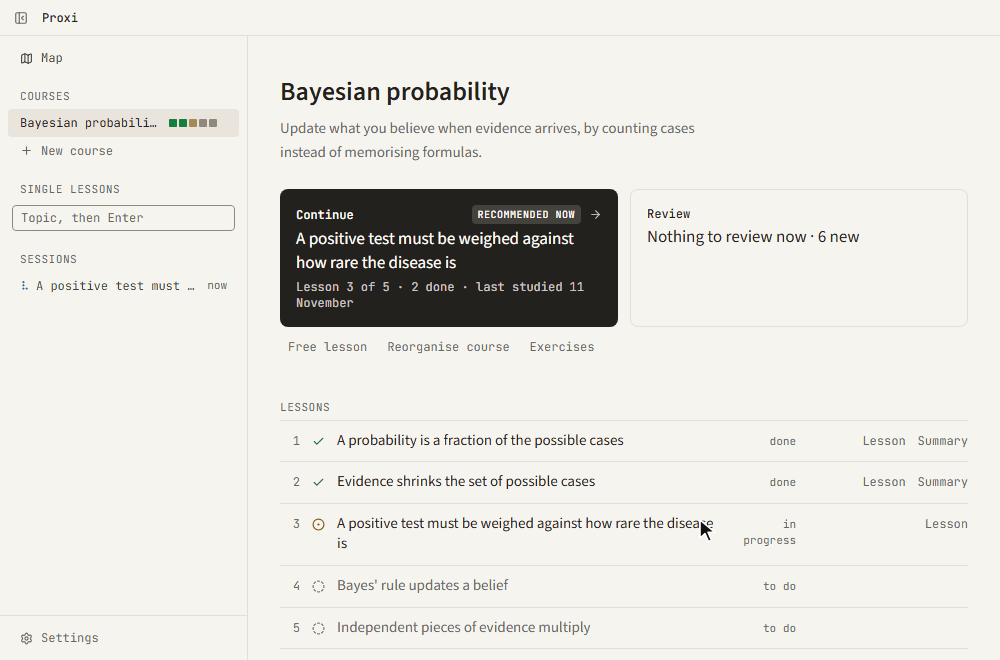
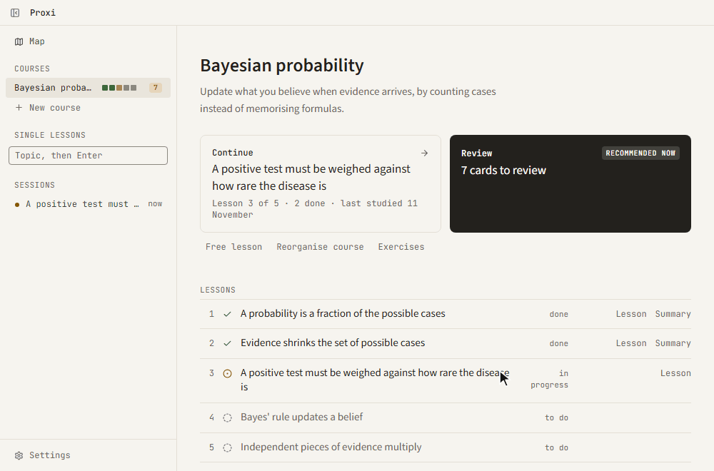
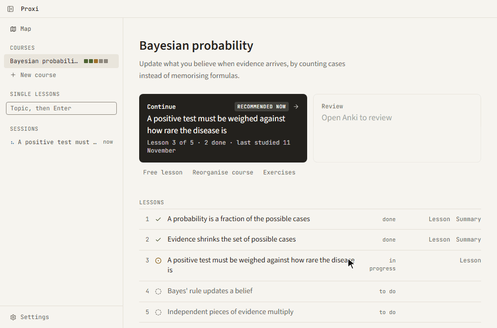

<div align="center">
  
  <h1>Proxi</h1>
  <p><b>Learn it with an AI teacher. Keep it with Anki.</b></p>
</div>

Heavily inspired by [LearnHarness](https://github.com/amosblomqvist/learnharness) and Matt Pocock's [/teach skill](https://github.com/mattpocock/skills/blob/main/skills/productivity/teach/SKILL.md), Proxi tries to get the best of both worlds and glue it to Anki spaced repetition, so what you learn actually stays.

Proxi does two things: it teaches you a topic in short interactive lessons, starting from what you already know, and it turns what you learned into Anki cards.
Each has one button: **Continue** and **Review**.

## How to use

### 1. Continue: learn the next lesson

Add a course with **New course**, then press **Continue**. The teacher asks for your guess first, explains one idea with figures and formulas, then checks that you got it. What you pass is saved as an Anki card.



### 2. Review: keep what you learned

Every idea you pass becomes an Anki card, if you said yes at the start of the lesson. When cards are due, **Review** is the suggested action and one click opens the course deck in Anki.



### 3. Exercises: practise what you learned

**Exercises** asks the teacher for practice on what you learned. For now that means written problems, quick quizzes and, on programming courses, coding exercises with tests. More kinds of problems are coming.



## Install

```bash
git clone https://github.com/davidef02/proxi.git
cd proxi
npm install
npm run desktop
```

On Windows, `npm run desktop:install` adds Start menu and Desktop shortcuts.

## Requirements

- Node 24
- One AI CLI, installed and logged in: Claude Code (`claude`), Antigravity (`agy`) or OpenCode (`opencode`)
- Optional: Anki with the AnkiConnect add-on; without it, decks are exported as TSV files
- Windows, macOS or Linux (desktop shortcuts are Windows-only)

## Build

```bash
npm run app:build
npm test
```

## License

AGPL-3.0-only, see [LICENSE](LICENSE). Proxi is a modified fork of LearnHarness, see [NOTICE](NOTICE).
